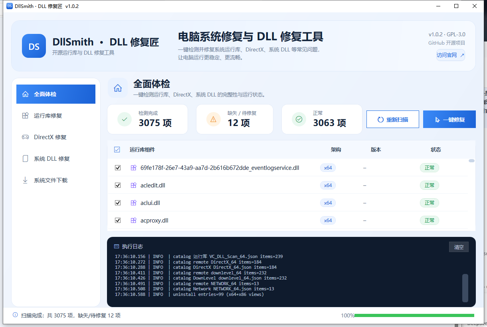
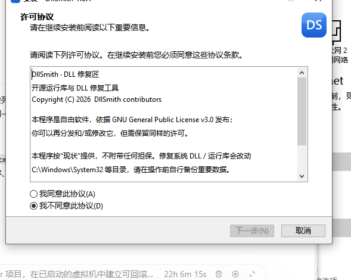

<div align="center">



# DllSmith

**Scan and repair Windows runtimes & system DLLs — open source, auditable, fully logged**

[](../../releases)
[](../../releases)
[](LICENSE)
[](#requirements)
[](https://dotnet.microsoft.com/)

[简体中文](README.md) · English · [Download](../../releases) · [Changelog](docs/versions.md) · [Issues](../../issues)

</div>

---

## Why

Missing DLL errors on Windows are painful to diagnose: users end up on shady download sites, reinstall Windows, or install random "all-in-one runtime packs" that break their system.

DllSmith turns it into three steps: **scan → review the list → one-click repair.**

| Symptom | Root cause | What DllSmith does |
|---|---|---|
| `VCRUNTIME140.dll is missing` | Visual C++ runtime absent | Detects VC++ 2005–2022, installs only what is missing (`/q /norestart`) |
| Games crash / black screen | DirectX components missing | Verifies DirectX components and `d3dcompiler_*.dll` |
| `0xc000007b` on launch | x86/x64 mismatch or missing system DLLs | Handles both architectures separately |
| `api-ms-win-*-l1-*-0.dll` not found | DownLevel API sets missing | Verifies the DownLevel component set |
| System DLL deleted by "cleaners" | File really is gone | Pulls the exact file, backs up before replacing |

No policy changes, no autostart entries, no background services — every action is logged.

## Features

**Detection**

- Five pages: full check, VC++ runtimes, DirectX, system DLLs, file downloads
- Three detection strategies picked per data shape:
  1. **File existence** — system DLLs, single-file components
  2. **Uninstall registry matching** — runtimes, fuzzy match on product family + year + arch (handles `2022 X64 Additional Runtime - 14.x` style names)
  3. **Wildcard + WinSxS index** — VC components often live only in the side-by-side store; a single directory index is built instead of scanning per item
- **Unknown ≠ missing**: undecidable entries are classified separately and never enter the repair queue
- Reads both `Registry64` and `Registry32`, and disables WOW64 file-system redirection while scanning

**Repair**

- Repairs only confirmed-missing items, with a confirmation showing `repair N, skip M healthy`
- CDN → signed object-storage URL fallback for downloads
- `*_encrypt` payloads decrypted with AES-128-CBC (IV prefix) and validated by magic bytes
- Silent install (`.exe`/`.msi`, exit-code + timeout checks), `.7z` extraction, single-file overwrite with `*.rebuild.bak` backup
- Live log panel and per-item status write-back

**Engineering**

- UI built entirely in code (no XAML compile step) — one `csc` invocation produces the exe
- Client can consume a catalog service per OS/arch, so the installer does not ship a dozen catalogs
- Update check on startup, mandatory updates enforced (download → SHA256 verify → run installer → exit)
- Inno Setup single-file installer with desktop shortcut and clean uninstall

## Screenshots

<div align="center">

**Full check** — missing list, status pills, live log


**Installer** — single file, custom wizard art, desktop icon


</div>

## Quick start

### Download

Everything ships through **[Releases](../../releases)** — each release contains `DllSmith-Setup-x.y.z.exe` (~2.8 MB) plus notes and the SHA256.

### Requirements

| Item | Requirement |
|---|---|
| OS | Windows 7 SP1 / 8 / 8.1 / 10 / 11 (x64) |
| Runtime | .NET Framework 4.8 (bundled on Win10 1809+) |
| Privileges | Administrator to repair system directories |
| Disk | ~20 MB |

### Usage

1. Launch from the desktop icon — the scan starts automatically
2. Review the missing items (each row can be toggled)
3. Click **Repair all**, confirm, and let it download/verify/install
4. Re-scan to verify; logs live in `Logs\`

## How it works

```
① catalog   GET /api/v1/catalog?key=<os_arch>   ← falls back to local Json\
              ↓
② scan      per item: file exists / uninstall name / MATCH wildcard (WinSxS index)
              ↓ result: present · missing · unknown (unknown never repaired)
③ repair    only missing + selected items
              ↓
④ download  plain URL, then signed storage URL as fallback
              ↓
⑤ decrypt   16-byte IV + AES-128-CBC → magic-byte validation
              ↓
⑥ apply     silent install / 7z extract / overwrite (WOW64 aware, with backup)
              ↓
⑦ verify    status write-back + logs
```

Client-facing catalog API:

| Endpoint | Purpose |
|---|---|
| `GET /api/v1/catalog?key=<catalog>` | Item array compatible with the original catalog JSON |
| `GET /api/v1/update?version=<v>` | Update check: version, url, sha256, notes, mandatory |
| `POST /api/v1/ping` | Online heartbeat (version distribution only) |
| `GET /api/v1/health` | Health check |

`config.json` next to the exe points the client at a service:

```json
{ "server": "http://your-server:8787" }
```

## Build from source

```powershell
powershell -ExecutionPolicy Bypass -File .\build.ps1          # produces bin\DllSmith.exe
& "C:\Program Files\Inno Setup 7\ISCC.exe" .\installer\DllSmith.iss
```

The client needs catalog data at runtime: put `Json\` next to the exe, or point `config.json` at a catalog service.

Self-check:

```powershell
.\bin\DllSmith.exe --scan-report .\scan-report.txt
```

## Tech

| Module | File | Responsibility |
|---|---|---|
| Entry | `src/Program.cs` | Single instance, crash handling, `--scan-report` |
| Core | `src/Core.cs` | Paths, logging, JSON, catalog model, probing, detection |
| Net | `src/ApiClient.cs` | Catalog fetch, update check, download URL resolution, heartbeat |
| Payload | `src/Payload.cs` | `*_encrypt` AES-128-CBC decryption |
| Repair | `src/RepairEngine.cs` | Download, decrypt, extract, install, overwrite |
| UI | `src/Ui.cs` | WPF UI built in code |
| Packaging | `installer/DllSmith.iss` | Inno Setup script |

## FAQ

<details><summary><b>It reports missing items, but I installed those runtimes.</b></summary>

Usually a different year or architecture of the same family. Open the row to see the detection basis, or run `--scan-report` for the full verdict.
</details>

<details><summary><b>Can it damage healthy files?</b></summary>

The repair queue only contains items classified as missing, the count is confirmed before starting, and single-file overwrites keep a `*.rebuild.bak` backup.
</details>

<details><summary><b>Why does it force me to update?</b></summary>

Repair rules live in the catalog. A mandatory update guarantees the client runs against current rules (download → SHA256 verify → run installer → exit).
</details>

## Roadmap

- [x] Five component families with scan/repair loop
- [x] Catalog service, online updates, mandatory updates
- [x] Single-file installer with desktop icon
- [ ] Repair history & rollback center
- [ ] Offline mode with cached payloads
- [ ] More UI languages
- [ ] Code signing to remove SmartScreen warnings

## License

[GPL-3.0](LICENSE). Provided "as is", without warranty of any kind. Back up your data before repairing system directories.
