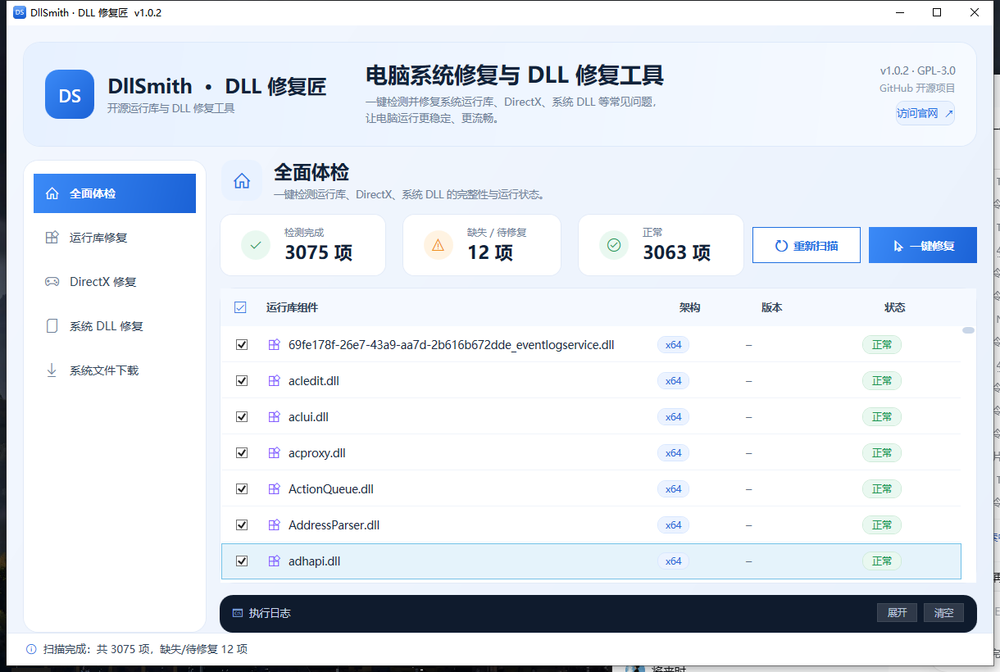
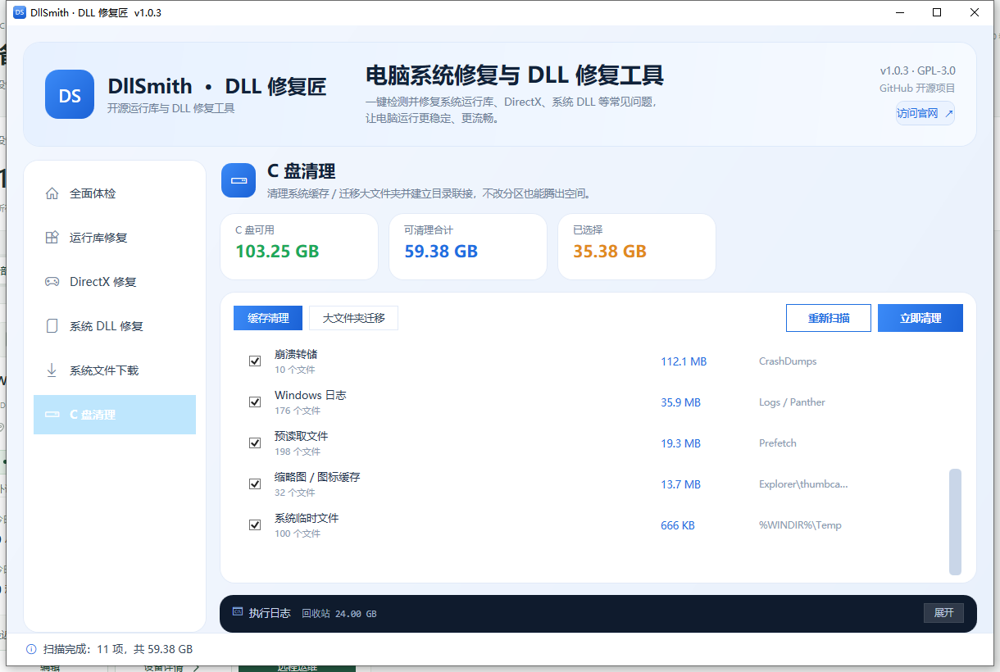

<div align="center">



# DllSmith · DLL 修复匠

**一键体检并修复 Windows 运行库与系统 DLL —— 开源、可审计、有日志**

[](../../releases)
[](../../releases)
[](LICENSE)
[](#系统要求)
[](https://dotnet.microsoft.com/)
[](../../stargazers)

[简体中文](README.md) · [English](README.en.md) · [下载](../../releases) · [版本记录](docs/versions.md) · [问题反馈](../../issues)

</div>

---

## 目录

- [它解决什么问题](#它解决什么问题)
- [功能特性](#功能特性)
- [界面预览](#界面预览)
- [快速开始](#快速开始)
- [工作原理](#工作原理)
- [技术架构](#技术架构)
- [从源码构建](#从源码构建)
- [常见问题](#常见问题)
- [路线图](#路线图)
- [已知限制](#已知限制)
- [参与贡献](#参与贡献)
- [许可](#许可)

---

## 它解决什么问题

Windows 上的“缺 DLL”几乎是每个用户都会遇到的故障，但排查路径极其分散：有人去搜 `VCRUNTIME140.dll` 下载站，有人重装系统，有人装一堆“运行库合集”把系统搞乱。

DllSmith 把这件事收敛成三步：**体检 → 看清单 → 一键修复**。

| 典型症状 | 背后原因 | DllSmith 的处理 |
|---|---|---|
| 打开软件提示「找不到 VCRUNTIME140.dll」 | 缺 Microsoft Visual C++ 运行库 | 识别 VC++ 2005–2022 各版本，缺哪个装哪个（静默 `/q /norestart`） |
| 游戏黑屏、闪退、提示 D3D 相关错误 | DirectX 组件缺失或版本不匹配 | 校验 DirectX 组件与 `d3dcompiler_*.dll` |
| 启动报 `0xc000007b` | 32/64 位组件错配、系统 DLL 缺失 | 同时识别 x86 / x64 两套组件，按架构精确匹配 |
| 提示缺少 `api-ms-win-*-l1-*-0.dll` | DownLevel API 集缺失 | 校验 DownLevel 组件集合 |
| 系统 DLL 被误删、被“优化软件”清掉 | 文件确实不在了 | 从目录源取同名文件，覆盖前自动备份 |
| 不知道到底缺什么 | 没有可信的检测手段 | 一键体检 + 缺失清单 + 执行日志 |

> 不改系统策略、不写开机启动、不驻留后台进程；所有改动都有日志，可回溯。

---

## 功能特性

### 检测

- **五个功能页**：全面体检 / 运行库修复 / DirectX 修复 / 系统 DLL 修复 / 系统文件下载
- **三种判定口径**，按数据形态自动选择：
  1. **文件存在性** —— 系统 DLL、单文件组件
  2. **卸载表匹配** —— 运行库，按 `DisplayName` 做「产品族 + 年份 + 架构」模糊匹配，避免 `2022 X64 Additional Runtime - 14.x` 这类名字差异导致漏判
  3. **通配 + WinSxS 索引** —— VC 组件常只存在于侧边存储，用一次性目录索引判定，不逐条全盘扫描
- **缺失置顶**：列表按状态排序，缺失项永远在最上面，正常项在下面
- **Unknown 不等于缺失**：无法判定的条目单独归类，既不算正常也不算缺失，**不会进入修复队列**
- **双注册表视图**：同时读 `Registry64` / `Registry32`，并对 32 位进程关闭 WOW64 文件系统重定向

### 修复

- 只处理**确认缺失**的项目，执行前二次确认：`将修复 N 项缺失组件，自动跳过 M 项正常组件`
- 下载地址自适应：目录里的普通地址失败时，自动改用对象存储签名地址
- 载荷解密：`*_encrypt` 载荷为 AES-128-CBC（IV 前置），解密后校验文件头（`MZ` / `7z` / `PK`）
- 三种落地方式：`.exe/.msi` 静默安装（退出码 + 超时判定）、`.7z` 解压、单文件覆盖（带 `*.rebuild.bak` 备份）
- 修复后状态回写列表；执行日志默认收成一行，可展开查看完整输出

### C 盘清理

- **缓存清理**：临时文件、Windows 更新缓存、传递优化、预读取、系统日志、崩溃转储、缩略图缓存、Edge/Chrome 缓存、回收站
  - 只清白名单目录；被占用的文件自动跳过并计入日志
  - **回收站默认不勾选**（清空不可恢复）
- **大文件夹迁移**：扫描 `%LOCALAPPDATA%` / `%APPDATA%` 下的大目录，搬到其他磁盘后**自动创建目录联接（Junction）**，软件照常运行
  - 迁移前校验目标盘剩余空间；`robocopy /MOVE` 复制并清理源目录
  - 失败自动回滚；成功写入回滚清单 `Logs\clean-<时间>.json`
- 三个统计卡：C 盘可用 / 可清理合计 / 已选择

### 工程

- 界面完全用代码构建（无 XAML 编译步骤），`csc` 一条命令即可产出 exe
- 客户端可接目录服务：按系统（Win7/8/10/11 × x86/x64）下发清单，安装包不必内置十几套目录
- 启动检查更新：确认后弹出下载进度窗（百分比 + 已下载/总大小），下载完成再启动安装包；强制更新模式下必须升级才能继续使用（SHA256 校验）
- 完整日志：`Logs\` 按天滚动，界面内置控制台式日志面板
- 安装包：Inno Setup 单文件安装器，桌面快捷方式、开始菜单、干净卸载

---

## 界面预览

<div align="center">

**全面体检** — 缺失清单、状态胶囊、执行日志


**安装向导** — 单文件安装、自定义品牌图、桌面图标


**更新下载** — 确定后显示百分比与进度，不让你干等


**C 盘清理** — 缓存清单按大小排序，勾选即清


</div>

---

## 快速开始

### 下载

所有版本都在 **[Releases](../../releases)** 发布，每个版本附带：

- `DllSmith-Setup-x.y.z.exe` — 安装包（约 2.8 MB）
- 发布说明 — 本次改动、修复项、SHA256

> 最新版本：[](../../releases/latest)

### 版本记录

| 版本 | 时间 | 主要改动 |
|---|---|---|
| **v1.1.0**（最新） | 2026-11-14 | 新增「C 盘清理」：缓存清理 + AppData 大文件夹迁移（Junction，可回滚） |
| v1.0.3 | 2026-11-13 | 缺失项置顶、日志默认收起、移除底部进度条、更新下载进度窗、按钮禁用配色 |
| v1.0.2 | 2026-11-13 | 客户端新增「访问官网」入口 |
| v1.0.1 | 2026-11-13 | 修复“一键修复误修正常项”、WinSxS 通配匹配、安装向导优化 |
| v1.0.0 | 2026-11-13 | 首个可运行版本：五页体检、识别与修复、目录服务对接 |

完整更新日志见 [docs/versions.md](docs/versions.md)。

### 系统要求

| 项 | 要求 |
|---|---|
| 系统 | Windows 7 SP1 / 8 / 8.1 / 10 / 11（x64） |
| 运行时 | .NET Framework 4.8（Win10 1809+ 自带） |
| 权限 | 修复系统目录需管理员权限（程序会提示提权） |
| 磁盘 | 约 20 MB（含目录数据） |

### 使用

1. 安装后从桌面图标启动，程序自动开始体检
2. 「缺失 / 待修复」卡片即为待处理数量，可逐项勾选
3. 点「一键修复」，确认后开始：下载 → 校验 → 安装/覆盖
4. 完成后可再次扫描复核；日志在 `Logs\` 目录

---

## 工作原理

```
① 取目录   GET /api/v1/catalog?key=<系统_架构>      ← 失败回退本地 Json\
              ↓
② 扫描     逐条判定：文件存在 / 卸载表名称 / MATCH 通配（WinSxS 索引）
              ↓ 结果：正常 · 缺失 · 未知（未知不参与修复）
③ 修复     仅处理「缺失」且被勾选的项
              ↓
④ 下载     普通地址 → 失败回退签名地址（oss_key = 路径去 /DLL/ + 补 _encrypt）
              ↓
⑤ 解密     首 16 字节 IV + AES-128-CBC 密文 → 校验文件头
              ↓
⑥ 落地     静默安装 / 7z 解压 / 单文件覆盖（WOW64 + 备份）
              ↓
⑦ 复核     状态回写、日志落盘
```

目录服务接口（客户端侧）：

| 接口 | 用途 |
|---|---|
| `GET /api/v1/catalog?key=<目录键>` | 拉取条目数组（字段与原目录 JSON 兼容） |
| `GET /api/v1/update?version=<版本>` | 更新检查：版本号、下载地址、SHA256、说明、是否强制 |
| `POST /api/v1/ping` | 在线心跳，仅用于版本分布统计 |
| `GET /api/v1/health` | 健康检查 |

`config.json` 放在 exe 同目录即可指定服务地址：

```json
{ "server": "http://your-server:8787" }
```

---

## 技术架构

| 模块 | 文件 | 职责 |
|---|---|---|
| 入口 | `src/Program.cs` | 单实例、异常兜底、`--scan-report` 自检 |
| 核心 | `src/Core.cs` | 路径与日志、JSON、目录模型、系统探测、扫描判定 |
| 网络 | `src/ApiClient.cs` | 目录拉取、更新检查、下载地址解析、心跳 |
| 载荷 | `src/Payload.cs` | `*_encrypt` 解密（AES-128-CBC） |
| 修复 | `src/RepairEngine.cs` | 下载、解密、解压、安装、文件覆盖 |
| 界面 | `src/Ui.cs` | WPF 界面（纯代码，主题/控件/页面） |
| 打包 | `installer/DllSmith.iss` | Inno Setup 安装包脚本 |

```
DllSmith/
├─ build.ps1                  # 客户端构建（csc + win32icon + 写 config.json）
├─ src/                       # 客户端源码
├─ installer/                 # 安装包脚本与素材
├─ docs/
│  ├─ versions.md             # 版本历史与发版流程
│  └─ screenshots/            # 文档截图
├─ README.md                  # 中文说明
└─ README.en.md               # English
```

---

## 从源码构建

```powershell
# 1) 编译客户端（产物在 bin\，需 .NET Framework 4.8 自带的 csc.exe）
powershell -ExecutionPolicy Bypass -File .\build.ps1

# 2) 打包安装器（需 Inno Setup 7）
& "C:\Program Files\Inno Setup 7\ISCC.exe" .\installer\DllSmith.iss
```

运行前需要有目录数据：把 `Json\` 放到 exe 同目录，或在 `config.json` 指向可用的目录服务。

自检命令：

```powershell
# 跑一遍完整扫描并把每条判定写入文件（排查"为什么会判缺失"）
.\bin\DllSmith.exe --scan-report .\scan-report.txt
```

---

## 常见问题

<details>
<summary><b>扫描显示缺失，但我确定装过运行库？</b></summary>

多半是安装的是同族但不同年份/架构的包。展开该条目可以看到判定依据（文件路径 / 卸载表名称）；也可以跑 `--scan-report` 看完整结论。
</details>

<details>
<summary><b>修复到一半失败怎么办？</b></summary>

日志面板与 `Logs\` 会记录每一步（下载地址、HTTP 状态、解密结果、安装退出码）。常见原因是下载源不可达或安装包被安全软件拦截。
</details>

<details>
<summary><b>会不会把正常文件改坏？</b></summary>

不会碰“正常”条目：修复队列只包含判定为缺失的项目，执行前还会列出数量确认；覆盖单个 DLL 时会先写 `*.rebuild.bak` 备份。
</details>

<details>
<summary><b>支持 32 位系统吗？</b></summary>

当前版本面向 x64；32 位目录数据在服务端存在，但安装包与检测逻辑优先保证 x64 正确性。
</details>

<details>
<summary><b>为什么启动时提示必须更新？</b></summary>

客户端按目录服务的最新版本做强制更新：下载 → 校验 SHA256 → 启动安装包 → 退出自身。这样能保证修复规则始终是最新的。
</details>

---

## 路线图

- [x] 五种组件检测与修复闭环
- [x] 目录服务 + 在线更新 + 强制更新
- [x] 单文件安装包与桌面图标
- [ ] 修复历史与回滚中心（按次记录改动了哪些文件）
- [ ] 离线模式：内置精简目录 + 本地缓存安装包
- [ ] 多语言界面（English / 繁體中文）
- [ ] 托盘化与计划任务体检
- [ ] 代码签名，消除 SmartScreen 提示

---

## 已知限制

- 目录条目依赖上游下载源，个别老版本安装包可能已下线
- 单文件覆盖只做 `*.rebuild.bak` 备份，没有系统还原点级回滚
- 目录数据（`Json\`）属运行期资产，仓库不内置
- 仅提供 x64 安装包

---

## 参与贡献

欢迎 issue / PR。可以做的事：

- 补充/修正目录条目与下载源
- 改进判定规则（尤其是运行库家族匹配）
- 界面细节、文案、多语言
- 打包与 CI（自动化构建 + Release 发布）

提交前请确保：

```powershell
powershell -File .\build.ps1           # 能编译
.\bin\DllSmith.exe --scan-report .\r.txt   # 能跑完扫描
```

---

## 许可

[GPL-3.0](LICENSE)。本程序按“现状”提供，不附带任何担保；修改系统目录前请自行备份重要数据。

<div align="center">

**如果这个项目帮到了你，欢迎点一个 ⭐**

</div>
