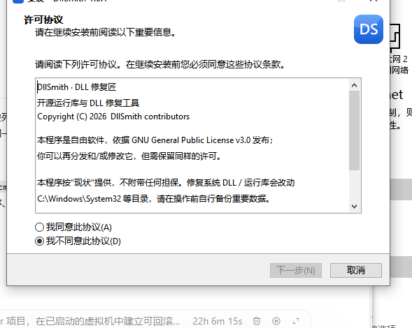

# DllSmith · DLL 修复匠

**开源（GPL-3.0）的 Windows 运行库 / 系统 DLL 修复工具。**
扫描 → 定位 → 下载（官方安装包或单文件）→ 校验 → 静默安装或覆盖，全过程有日志、可审计。

> English: An open-source (GPL-3.0) Windows runtime & system DLL repair tool — scan, locate, download, verify, install, with full logging.
> 本项目是独立实现，与 4DDiG / Tenorshare 等商业软件**没有任何关联**。


---

## 它能解决什么问题

| 场景 | 表现 | DllSmith 怎么做 |
|---|---|---|
| 新装/精简版系统缺运行库 | 软件打不开，提示缺少 `VCRUNTIME140.dll`、`MSVCP140.dll` | 检测 Microsoft Visual C++ 2005–2022 运行库，缺哪个装哪个（静默参数 `/q /norestart`） |
| 游戏启动失败 | DirectX 相关 DLL 缺失、黑屏、闪退 | 校验 DirectX 组件与 `d3dcompiler_*.dll`，按需补齐 |
| 0xc000007b / 应用初始化失败 | 32/64 位混淆、系统 DLL 缺失 | 同时识别 x86 / x64 两套组件，按架构匹配 |
| `api-ms-win-*-l1-*-0.dll` 找不到 | UWP/新版程序无法启动 | 校验 DownLevel 组件集合 |
| 系统 DLL 被误删、被“优化软件”清掉 | 资源管理器/程序报错 | 从镜像源拉取同名文件，覆盖前自动备份 |
| 不知道到底缺什么 | 只能靠人肉搜索 | 一键体检：运行库 + DirectX + 系统 DLL 全量扫描，给出缺失清单 |

> 不修改系统策略、不写开机启动、不驻留进程；所有改动都写日志，可回滚。

---

## 主要功能

- **五个功能页**：全面体检 / 运行库修复 / DirectX 修复 / 系统 DLL 修复 / 系统文件下载
- **三种判定口径**（避免误报）：
  1. 文件存在性（系统 DLL、单文件组件）
  2. 卸载表 `DisplayName` 匹配（运行库，含产品族 + 年份 + 架构的模糊匹配）
  3. `MATCH` 通配 + **WinSxS 索引**（VC 组件常见于侧边存储，需要按文件名在 WinSxS 里找）
  - 无法判定的条目归为 `Unknown`，**既不算正常也不算缺失**，不会被误修
- **一键修复只处理“缺失”项**，执行前二次确认：`将修复 N 项缺失组件，自动跳过 M 项正常组件`
- **下载地址自适应**：先用目录里的普通 CDN 地址，失败自动改用对象存储签名地址
- **载荷解密**：`*_encrypt` 载荷为 AES-128-CBC（IV 前置），解密校验后再安装
- **修复动作**：`.exe/.msi` 静默安装（超时 + 退出码判定）；`.7z` 解压；单文件直接覆盖（WOW64 重定向处理 + `.rebuild.bak` 备份）
- **在线目录**：客户端从目录服务按系统（Win7/8/10/11 × x86/x64）拉取清单，不用把十几个版本目录塞进安装包
- **强制更新**：发布新版本后，旧客户端启动即提示更新，不更新不能继续使用
- **在线状态上报**：客户端每 60 秒发送一次心跳，用于版本分布统计
- **完整日志**：`Logs\` 按天滚动，控制台式日志面板可一键清空

---

## 截图

### 主界面（全面体检）


### 安装向导（自定义左侧图 + 图标，桌面快捷方式）



---

## 工作原理

```
① 取目录   服务端 /api/v1/catalog?key=<系统_架构>   ← 失败回退本地 Json\
             ↓
② 扫描     逐条判定：文件存在 / 卸载表名称 / MATCH 通配(WinSxS 索引)
             ↓ 结果：正常 / 缺失 / 未知（未知不参与修复）
③ 修复     仅处理“缺失”且勾选的项
             ↓
④ 下载     普通地址 → 失败回退 OSS 签名地址（oss_key 规则：去 /DLL/ 段 + 补 _encrypt）
             ↓
⑤ 解密     首 16 字节 IV + AES-128-CBC 密文 → 校验文件头（MZ / 7z / PK）
             ↓
⑥ 落地     安装包静默安装 / 压缩包 7z 解压 / 单文件覆盖（带备份）
             ↓
⑦ 复核     状态回写列表，日志落盘
```

服务端还会下发版本信息（`/api/v1/update`），客户端据此强制更新。

---

## 快速开始

## 版本与下载

| 版本 | 时间 | 主要内容 | 下载 |
|---|---|---|---|
| **v1.0.1**（最新，强制更新） | 2026-11-13 | 修复“一键修复误修正常项”、WinSxS 匹配、安装向导优化 | [本站](http://123.57.94.141:8787/files/DllSmith-Setup-1.0.1.exe) · [GitHub](https://github.com/as851500663/DllSmith/releases/download/v1.0.1/DllSmith-Setup-1.0.1.exe) |
| v1.0.0 | 2026-11-13 | 首个可运行版本：五页体检、识别与修复、目录服务对接 | [本站](http://123.57.94.141:8787/files/DllSmith-Setup-1.0.0.exe) |

- 在线版本页（自动生成）：<http://123.57.94.141:8787/versions>
- 完整更新日志：[docs/versions.md](docs/versions.md)
- SHA256（1.0.1）：`c74b663bb58c32cb58874eea283d1911003ba5275af510a240bb9bcd63a5ba45`

---
### 方式一：安装包

| 下载源 | 地址 |
|---|---|
| 官方下载页（推荐） | http://123.57.94.141:8787/download |
| 直链 | http://123.57.94.141:8787/files/DllSmith-Setup-1.0.1.exe |
| GitHub Releases（镜像） | https://github.com/as851500663/DllSmith/releases/latest |

1. 下载 `DllSmith-Setup-1.0.1.exe`（2.7 MB）
2. 双击安装（默认装到 `C:\Program Files\DllSmith`，会在桌面创建快捷方式）
3. 打开后会自动体检；勾选「缺失」项 → 一键修复

> SHA256：`c74b663bb58c32cb58874eea283d1911003ba5275af510a240bb9bcd63a5ba45`
> 安装包未做代码签名，Windows SmartScreen 可能提示「未知发布者」，选择「更多信息 → 仍要运行」。

> 修复 `C:\Windows\System32` 下的文件需要管理员权限，程序会提示提权。

### 方式二：从源码构建

依赖：Windows + .NET Framework 4.8（系统自带）、`csc.exe`（`C:\Windows\Microsoft.NET\Framework\v4.0.30319\`）

```powershell
# 客户端（产物在 bin\）
powershell -ExecutionPolicy Bypass -File .\build.ps1

# 安装包（需 Inno Setup 7）
& "C:\Program Files\Inno Setup 7\ISCC.exe" .\installer\DllSmith.iss
```

运行客户端需要目录数据：把 `Json\` 放到 exe 同目录，或在 `config.json` 里指向目录服务：

```json
{ "server": "http://your-server:8787" }
```

### 方式三：对接目录服务（接口公开）

客户端与目录服务之间是**纯 HTTP + JSON**，接口契约如下，你可以自行实现兼容服务：

| 接口 | 说明 |
|---|---|
| `GET /api/v1/catalog?key=<目录键>` | 返回条目数组，字段与原目录 JSON 兼容（`FILENAME/FILEPATH/DOWNLOAD` 或 `DISPLAYNAME/DISPLAYVERIONS/MATCH/DOWNLOADDLL`） |
| `GET /api/v1/update?version=<客户端版本>&channel=stable` | `{"update":bool,"version":"x.y.z","url":"...","sha256":"...","notes":"...","mandatory":bool}` |
| `POST /api/v1/ping`（表单 `machine`、`version`） | 在线心跳，仅用于统计 |
| `GET /api/v1/health` | 健康检查 |

在 exe 同目录的 `config.json` 写入服务地址即可：

```json
{ "server": "http://your-server:8787" }
```

> 目录服务按上述契约提供，`config.json` 里的地址指向可用的服务即可。

---

## 目录结构

```
DllSmith/
├─ build.ps1                  # 客户端构建（csc + win32icon + 自动写 config.json）
├─ src/
│  ├─ Program.cs              # 入口 / 单实例 / --scan-report 自检
│  ├─ Core.cs                 # 路径、日志、JSON、目录模型、系统探测、扫描判定
│  ├─ ApiClient.cs            # 目录服务 / 更新检查 / 下载地址解析 / 心跳
│  ├─ Payload.cs              # *_encrypt 载荷解密
│  ├─ RepairEngine.cs         # 下载 / 解密 / 解压 / 安装 / 覆盖
│  ├─ Ui.cs                   # WPF 界面（纯代码构建，无需 XAML 编译）
│  └─ app.manifest, app.ico   # 清单与图标
├─ installer/                 # Inno Setup 脚本与向导素材
└─ docs/screenshots/          # 文档截图
```

---

## 版本与更新策略

| 服务端状态 | 客户端行为 |
|---|---|
| 无更新 / 未配置 server / 请求失败 | 静默继续，本地照常可用 |
| 有更高版本 | 弹「需要更新」，**只有确定**：下载 → SHA256 校验 → 启动安装包 → 自身退出 |
| 下载或校验失败 | 提示后退出（不允许用旧版本继续跑） |

---

## 已知限制

- 目录里的普通 CDN 地址可能失效，此时依赖对象存储签名地址；两者都不可达时该条目会报下载失败
- 单文件覆盖只备份为 `*.rebuild.bak`，没有系统还原点级别的回滚
- 服务端默认 HTTP，部署到公网请在前面加 Nginx/Caddy 做 TLS
- 仅中文界面；多语言文案尚未接入
- 目录数据（`Json\`）是运行期资产，仓库不附带，请自建或由服务端下发
- 目录服务默认走 HTTP，公网部署建议自行加 TLS 反代

---

## 参与贡献

欢迎 issue / PR：补充语言、改进判定规则、优化界面与日志、完善安装包都可以。
提交前请确保 `powershell -File .\build.ps1` 能编译通过，并跑一次 `--scan-report` 附上结果。

---

## 许可

[GPL-3.0](LICENSE)。本程序按“现状”提供，不附带任何担保；修改系统目录前请自行备份。
